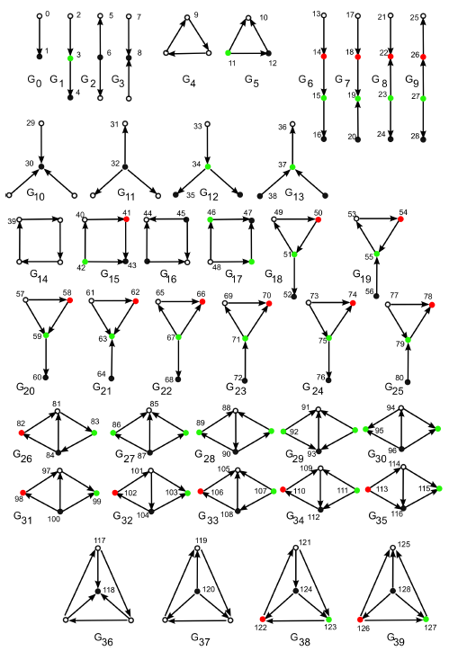

<div align="center">


# Graphlet-Based Network Comparison Distances for Directed Networks

**Supplementary information for "Graphlet-based Characterization of Directed Networks"**

**A. Sarajlić, N. Malod-Dognin, Ö. N. Yaveroğlu and N. Pržulj**

Corresponding author: Prof. N. Pržulj, natasa.przulj@mbzuai.ac.ae



</div>

This is the software and Python script we used to compute the directed network distances presented in our paper, including the Directed Graphlet Correlation Distance (DGCD), the Directed Relative Graphlet Frequency Distribution Distance (DRGF) and the Directed Graphlet Degree Distribution Agreement (DGDDA).

## Code

- [C++ code for computing directed graphlet degree vector (DGDV) signatures](Directed_Graphlet_Counter_v3)
- [Python script for network comparison](Directed_Distances_v2.py) (`Directed_Distances_v2.py`)

## Usage

1. All directed networks must be in edge-list format.

2. Compute the directed graphlet degree vector signatures of each network with the C++ counter:
   ```bash
   ./Directed_Graphlet_Counter_v3 my_network
   ```
   This produces three files:
   - `my_network.graphletcounts.txt`: counts of directed graphlets in the network (e.g. for DRGF)
   - `my_network.signatures.txt`: directed graphlet degree signatures of the nodes, one per line (e.g. for DGCD)
   - `my_network.dictionary.txt`: maps line numbers in the signature file to node IDs

3. Compute the distances:
   ```bash
   python Directed_Distances_v2.py <clusters_folder> <test_mode> <process_count>
   ```
   - `clusters_folder`: contains one subfolder per cluster of networks. Each subfolder holds the signature files of its networks, plus the `.gw` (LEDA) files when using test mode 3. File names must match exactly across file types.
   - `test_mode`: the distance to compute (default 1, see table below)
   - `process_count`: number of parallel processes, 1 or more (default 4)

   For example, DGCD-13 with 4 processes:
   ```bash
   python Directed_Distances_v2.py clusters 1 4
   ```

## Available distances

| Test mode | Distance |
|---|---|
| `1` | DGCD-13: directed graphlet correlation distance, 2- to 3-node directed graphlet orbits (default) |
| `2` | DGCD-129: directed graphlet correlation distance, 2- to 4-node directed graphlet orbits |
| `3` | RDGF distance |
| `4` | DGDDA |
| `5` | Directed spectral distance |
| `6` | In- and out-degree distribution distances |

## Citation

A. Sarajlić, N. Malod-Dognin, Ö. N. Yaveroğlu and N. Pržulj. Graphlet-based characterization of directed networks. *Scientific Reports* 6, 35098 (2016). https://doi.org/10.1038/srep35098
